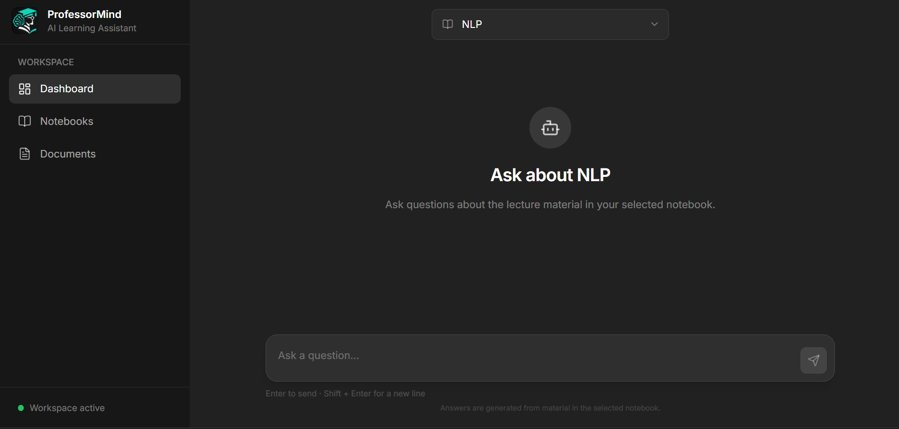
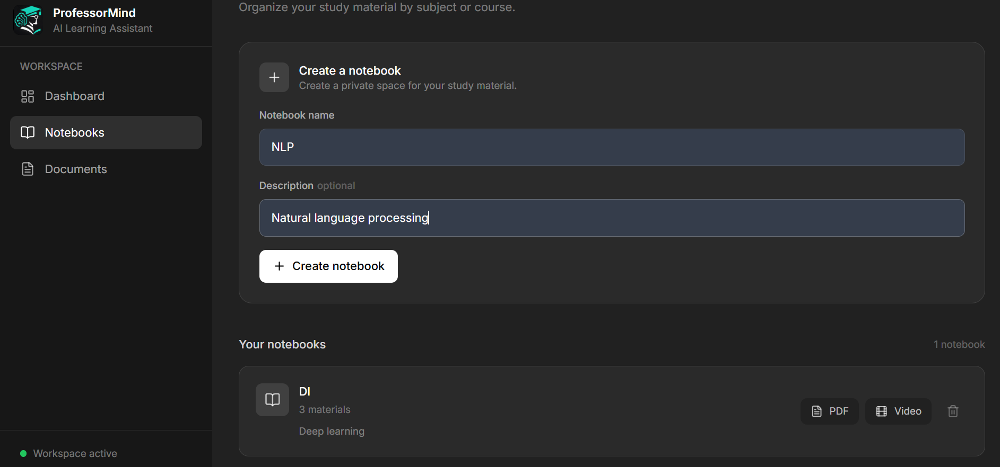
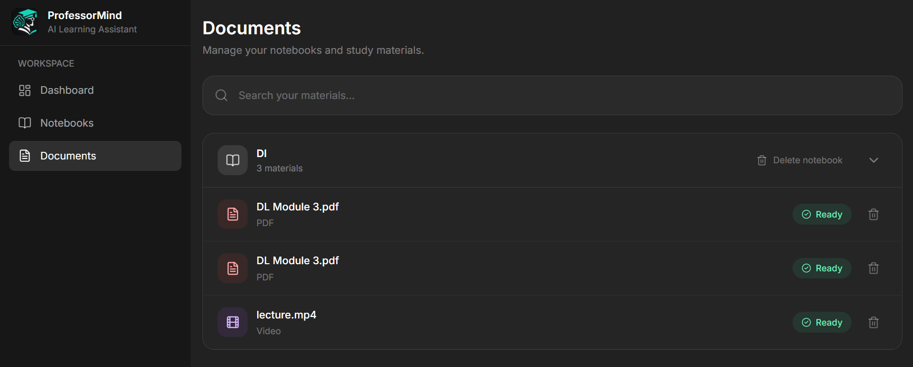
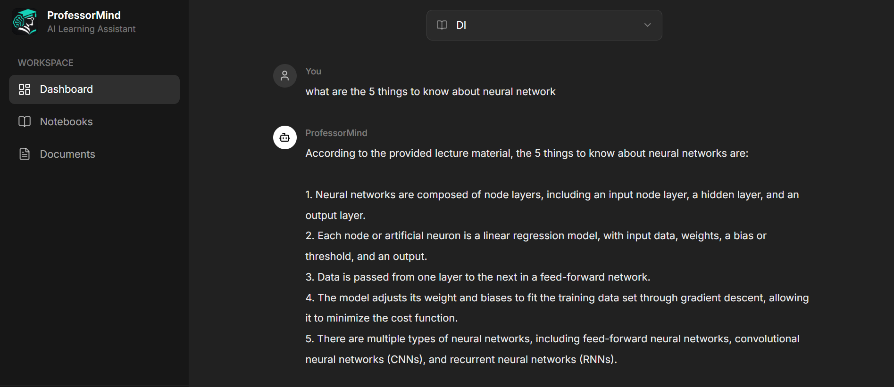

# ProfessorMind AI

## Professor-Centric Multimodal AI Learning Assistant

ProfessorMind AI is a private, professor-centric AI learning assistant
that allows students to create subject-specific knowledge bases from
their own academic materials.

The system uses **Retrieval-Augmented Generation (RAG)** to retrieve
relevant information from uploaded learning resources and generate
answers grounded in the selected notebook's content.

Students can create separate notebooks for subjects, upload multiple
PDFs and lecture videos, and ask questions across the materials stored
in each notebook. Each notebook maintains its own source files and FAISS
vector index to keep subject knowledge isolated.

The current prototype supports PDF and video ingestion. Image/OCR
processing and broader multimodal understanding are planned extensions.

---

## Application Screenshots

Add or update screenshots in `assets/screenshots/` and keep the
filenames below aligned with the actual files in your repository.

### 1. Main Interface



### 2. Notebook Management



### 3. Document Management



### 4. Dashboard



---

## Project Overview

Students often have lecture notes, PDFs, presentations, recorded
lectures, and other academic resources spread across different
locations. Finding relevant information across these materials can take
time.

ProfessorMind AI provides a centralized, private knowledge base for each
subject. Each subject is represented as a **Notebook**. A notebook can
contain multiple supported learning resources, and its content is
indexed independently.

```text
Student
  |
  +-- NLP Notebook
  |     +-- HMM.pdf
  |     +-- POS.pdf
  |     +-- Lecture video
  |     +-- NLP FAISS knowledge base
  |
  +-- Machine Learning Notebook
  |     +-- Regression.pdf
  |     +-- Classification.pdf
  |     +-- Lecture video
  |     +-- ML FAISS knowledge base
  |
  +-- Deep Learning Notebook
        +-- CNN.pdf
        +-- RNN.pdf
        +-- Lecture video
        +-- DL FAISS knowledge base
```

The notebook-specific architecture ensures that retrieval for one
subject does not unintentionally mix content from another subject.

---

## Current Features

### Notebook Management

- Create subject-specific notebooks.
- List and view notebooks.
- Delete notebooks.
- Maintain separate source storage for each notebook.
- Maintain a separate FAISS index for each notebook.

### PDF Knowledge Base

- Upload PDF files to a selected notebook.
- Support multiple PDFs within one notebook.
- Extract PDF text using PyMuPDF.
- Split extracted text into overlapping chunks.
- Generate vector embeddings using Sentence Transformers.
- Store embeddings in the notebook-specific FAISS index.
- Preserve document and page metadata for source references.

### Video Knowledge Base

- Upload lecture videos to a selected notebook.
- Extract audio from uploaded videos.
- Transcribe speech using Whisper.
- Split transcript text into chunks.
- Generate embeddings for transcript chunks.
- Add video transcript embeddings to the selected notebook's FAISS
  knowledge base.

Timestamp-based retrieval and display should be considered supported
only where the relevant implementation is enabled and tested.

### Retrieval-Augmented Generation

- Ask questions using the selected notebook's knowledge base.
- Retrieve relevant chunks from indexed documents and video
  transcripts.
- Build context from retrieved content.
- Generate answers using Groq-powered LLM inference.
- Return source information where available, including document and
  page references.
- Apply retrieval filtering and duplicate handling.
- Keep answers grounded in uploaded notebook content.
- Use an explicit fallback when the requested information is outside
  the available uploaded material.

### Document Management

- View documents associated with a notebook.
- View document metadata.
- Delete individual documents.
- Rebuild the notebook's FAISS index after document deletion.
- Delete notebook storage when a notebook is deleted.

### Frontend

- React-based dashboard.
- Select a notebook for a conversation.
- Ask questions through a chat interface.
- Upload and manage learning resources.
- View notebook and document information.
- Render assistant responses with Markdown formatting, including
  headings, lists, tables, and code formatting.

---

## Technology Stack

Category Technologies

---

Backend Python, FastAPI
Database SQLite, SQLAlchemy
PDF processing PyMuPDF
Video processing MoviePy
Speech recognition OpenAI Whisper
Embedding framework Sentence Transformers
Embedding model `all-MiniLM-L6-v2`
Embedding dimension 384
Vector search FAISS
LLM inference Groq API
Frontend React, TypeScript, Vite
Styling Tailwind CSS
Markdown rendering React Markdown, remark-gfm
API documentation Swagger UI, OpenAPI

---

## System Architecture

```text
                         Student
                            |
                            v
                         Notebook
                            |
              +-------------+-------------+
              |                           |
              v                           v
          PDF Files                  Video Files
              |                           |
              v                           v
        Text Extraction              Audio Extraction
              |                           |
              v                           v
           Chunking                    Whisper
              |                           |
              |                           v
              |                     Transcription
              |                           |
              |                           v
              |                        Chunking
              |                           |
              +-------------+-------------+
                            |
                            v
                    Embedding Generation
                            |
                            v
                  Notebook-specific FAISS
                            |
                            v
                      User Question
                            |
                            v
                    Query Embedding
                            |
                            v
                    Similarity Search
                            |
                            v
                     Relevant Chunks
                            |
                            v
                    Context Construction
                            |
                            v
                       Groq LLM
                            |
                            v
                   Generated Answer
                            |
                            v
                  Answer + Source Details
```

---

## Storage Architecture

Each notebook stores its source files and its own FAISS index.

```text
storage/
└── notebooks/
    ├── <notebook_id>/
    │   ├── sources/
    │   │   ├── document_1.pdf
    │   │   └── lecture_video.mp4
    │   └── faiss/
    │       ├── index.faiss
    │       └── metadata.pkl
    │
    └── <notebook_id>/
        ├── sources/
        └── faiss/
```

The exact files stored in each directory depend on the ingestion and
indexing implementation.

This design provides:

- Subject-level separation of knowledge.
- Multiple sources within one notebook.
- Independent retrieval indexes.
- Notebook-level cleanup and deletion.

Uploaded academic materials, generated indexes, and local database files
should not be committed to the public repository.

---

## RAG Pipeline

### PDF Pipeline

```text
PDF Upload
    |
PDF Text Extraction
    |
Text Chunking
    |
Embedding Generation
    |
Notebook-specific FAISS Index
```

### Video Pipeline

```text
Video Upload
    |
Audio Extraction
    |
Whisper Transcription
    |
Transcript Chunking
    |
Embedding Generation
    |
Notebook-specific FAISS Index
```

### Question Answering Pipeline

```text
User Question
    |
Query Embedding
    |
Notebook FAISS Similarity Search
    |
Relevant Chunk Retrieval
    |
Context Construction
    |
Groq LLM
    |
Generated Answer + Available Sources
```

The question-answering pipeline uses retrieved notebook content as
context. The intended behavior is to avoid presenting unsupported
external information as if it came from the user's uploaded material.

---

## API Endpoints

The following table documents the main routes used by the application.
Confirm route names against the current FastAPI Swagger documentation at
`/docs` if the implementation changes.

### Notebook APIs

Method Endpoint Description

---

POST `/api/notebooks` Create a notebook
GET `/api/notebooks` List notebooks
GET `/api/notebooks/{notebook_id}` Retrieve a notebook
DELETE `/api/notebooks/{notebook_id}` Delete a notebook

### Upload and Document APIs

---

Method Endpoint Description

---

POST `/api/notebooks/{notebook_id}/upload-pdf` Upload and process a
PDF

POST `/api/notebooks/{notebook_id}/upload-video` Upload and process a
video

GET `/api/notebooks/{notebook_id}/documents` List notebook documents

DELETE `/api/notebooks/{notebook_id}/documents/{file_id}` Delete a document

---

### RAG API

Method Endpoint Description

---

POST `/api/ask` Ask a question using notebook knowledge

### Example Question Request

```json
{
  "notebook_id": "your-notebook-id",
  "question": "Explain the Hidden Markov Model",
  "top_k": 8
}
```

### API Documentation

After starting the backend, open:

```text
http://127.0.0.1:8000/docs
```

---

## Project Structure

The following is a high-level overview. Some supporting files and
subdirectories may be omitted.

```text
ProfessorMindAI/
│
├── backend/
│   ├── api/
│   │   ├── document.py
│   │   ├── notebook.py
│   │   ├── question.py
│   │   └── upload.py
│   │
│   ├── models/
│   │   ├── document.py
│   │   └── notebook.py
│   │
│   ├── services/
│   │   ├── context_builder.py
│   │   ├── embedding_service.py
│   │   ├── llm_service.py
│   │   ├── pdf_extractor.py
│   │   ├── rag_service.py
│   │   ├── retrieval_service.py
│   │   ├── text_chunker.py
│   │   └── vector_store.py
│   │
│   ├── database.py
│   └── main.py
│
├── frontend/
│   ├── src/
│   │   ├── components/
│   │   ├── pages/
│   │   ├── services/
│   │   ├── types/
│   │   └── App.tsx
│   ├── package.json
│   └── vite.config.ts
│
├── storage/
│   └── notebooks/
│
├── .env.example
├── .gitignore
├── requirements.txt
└── README.md
```

---

## Installation and Setup

### Prerequisites

Install the following before running the project:

- Python 3.11
- Node.js and npm
- Git
- A Groq API key

Video processing may also require the system dependencies used by the
installed MoviePy/FFmpeg configuration.

### 1. Clone the Repository

```bash
git clone https://github.com/OmkarDeshmukh001/ProfessorMindAI.git
cd ProfessorMindAI
```

### 2. Create a Python Virtual Environment

```bash
python -m venv venv
```

### 3. Activate the Virtual Environment

**Windows Git Bash**

```bash
source venv/Scripts/activate
```

**Windows CMD**

```cmd
venv\Scripts\activate
```

### 4. Install Backend Dependencies

```bash
pip install -r requirements.txt
```

### 5. Configure Environment Variables

Create a `.env` file in the project root.

```env
GROQ_API_KEY=your_groq_api_key
GROQ_MODEL=openai/gpt-oss-120b
```

Replace the placeholder with your own Groq API key.

**Security:** Never commit `.env` or expose your API key. Keep `.env`
excluded through `.gitignore`.

### 6. Run the Backend

From the project root:

```bash
python -m uvicorn backend.main:app --reload
```

Backend URL:

```text
http://127.0.0.1:8000
```

Swagger documentation:

```text
http://127.0.0.1:8000/docs
```

### 7. Install Frontend Dependencies

Open another terminal and navigate to the frontend directory:

```bash
cd frontend
npm install
```

### 8. Configure Frontend Environment

Create a `.env` file inside `frontend/`:

```env
VITE_API_URL=http://127.0.0.1:8000
```

### 9. Run the Frontend

From the `frontend/` directory:

```bash
npm run dev
```

The Vite development server will display the local frontend URL,
typically:

```text
http://localhost:5173
```

Keep the backend and frontend terminals running while using the
application.

---

## Development Status

The status below is a project-level snapshot. Mark a feature as
completed only after verifying it in the current codebase.

### Implemented

- [x] FastAPI backend
- [x] SQLite database integration
- [x] Notebook creation and listing
- [x] Notebook-specific storage
- [x] Notebook deletion
- [x] PDF upload and text extraction
- [x] Text chunking
- [x] Sentence Transformer embeddings
- [x] Notebook-specific FAISS indexes
- [x] Multiple PDFs in a notebook
- [x] Notebook-based retrieval
- [x] Context construction
- [x] Groq LLM integration
- [x] RAG question answering
- [x] PDF source and page references
- [x] Document listing and deletion
- [x] FAISS rebuilding after document deletion
- [x] React frontend and backend integration
- [x] Notebook selection and chat interface
- [x] Markdown rendering for assistant responses
- [x] Video upload and transcription pipeline

### Planned / Future Work

- [ ] Image ingestion and OCR
- [ ] Broader multimodal retrieval
- [ ] Improved timestamp-based video retrieval and source display
- [ ] Authentication
- [ ] Student and user management
- [ ] Further evaluation of retrieval quality and answer grounding
- [ ] Production deployment and monitoring

---

## Future Multimodal Architecture

The long-term objective is to extend the notebook knowledge base to
additional academic formats.

```text
                         Notebook
                            |
             +--------------+--------------+
             |              |              |
             v              v              v
            PDF           Video          Image
             |              |              |
       Text Extraction   Whisper           OCR
             |         Transcription        |
             |              |              |
             +--------------+--------------+
                            |
                            v
                  Unified Knowledge Base
                            |
                            v
                    Vector Retrieval
                            |
                            v
                       RAG Pipeline
                            |
                            v
                         LLM
                            |
                            v
                 Grounded Learning Answer
```

Potential future extensions include image understanding, OCR for
handwritten notes, richer audio understanding, lecture-level video
retrieval, timestamp references, and multimodal question answering.

---

## Project Goals

ProfessorMind AI aims to provide:

- Private academic knowledge retrieval.
- Subject-specific knowledge bases.
- Multi-document question answering.
- Lecture material understanding.
- Source-grounded responses.
- A unified retrieval experience across supported academic resources.
- Personalized student learning assistance.
- An extensible foundation for multimodal learning.

---

## Disclaimer

ProfessorMind AI is an academic project and research prototype developed
for educational purposes.

The current implementation focuses on notebook-based PDF and video
ingestion and retrieval-augmented question answering. Image/OCR
processing and additional multimodal capabilities are planned
extensions. Actual functionality may vary as development progresses.

---

## Author

**Omkar Deshmukh**

- GitHub: [OmkarDeshmukh001](https://github.com/OmkarDeshmukh001)

---

## Contributing

Suggestions, bug reports, and improvements are welcome. For significant
changes, consider opening an issue before submitting a pull request.

---

## License

No license has been specified yet. If you intend to make this repository
open source, add an appropriate `LICENSE` file and update this section.
